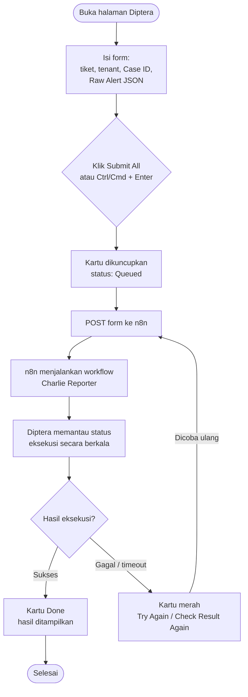
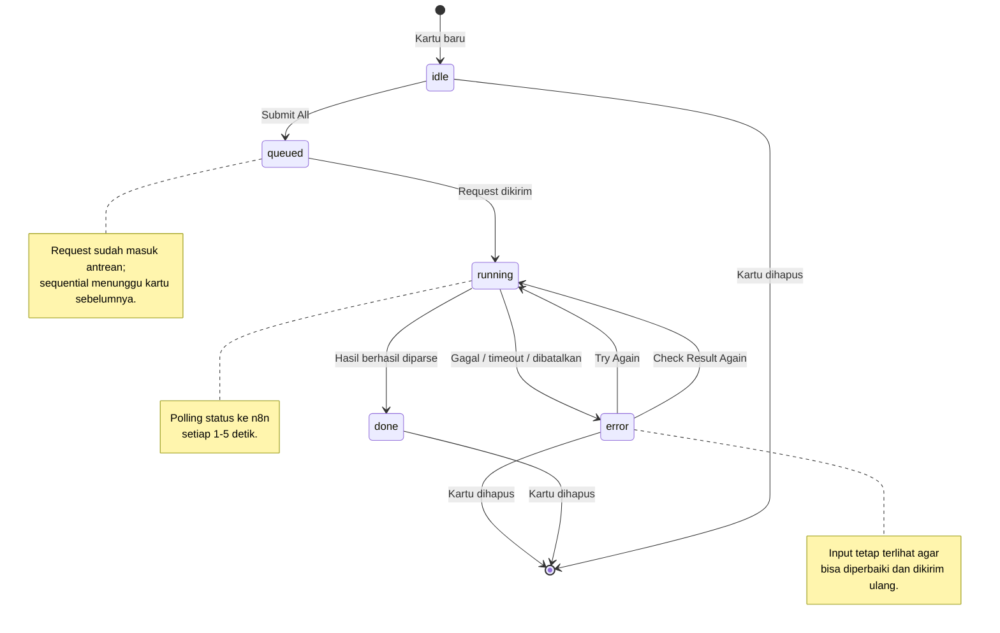
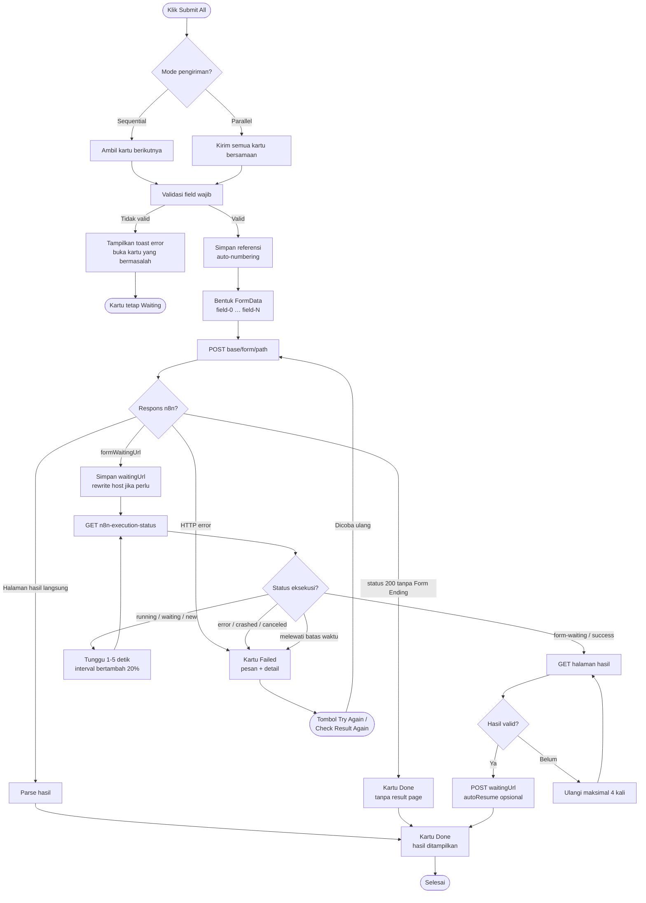
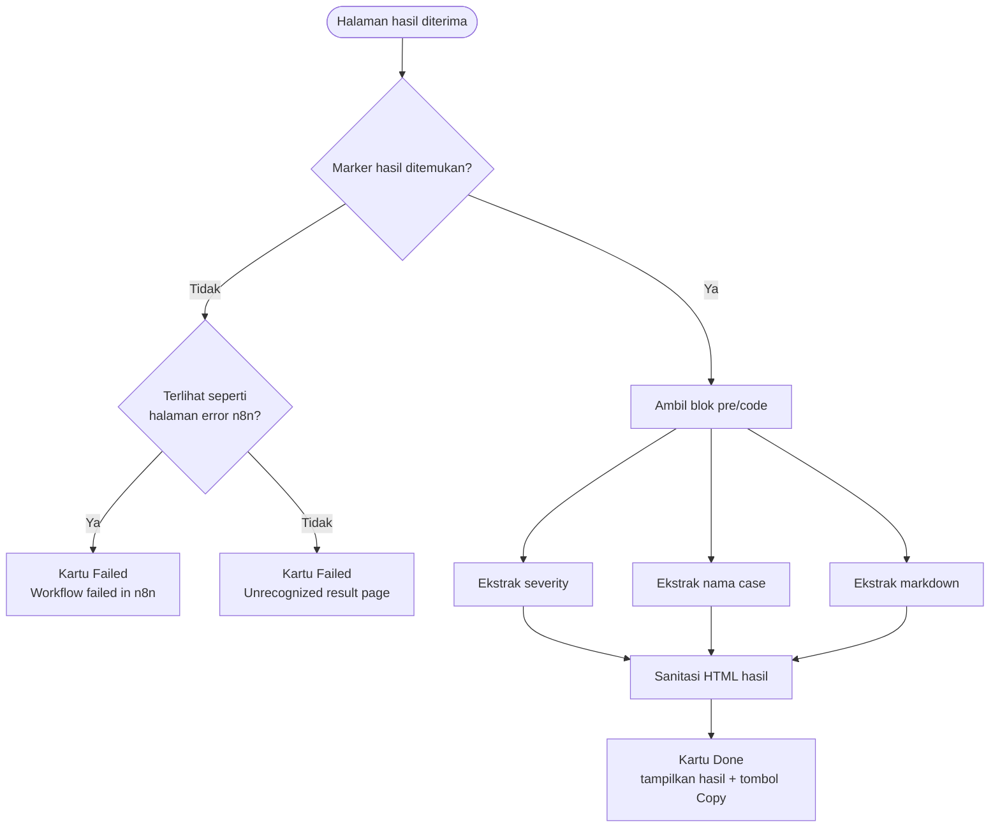
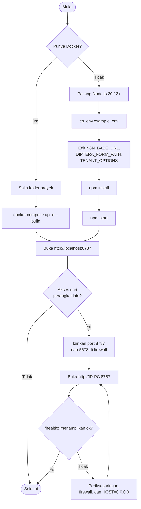
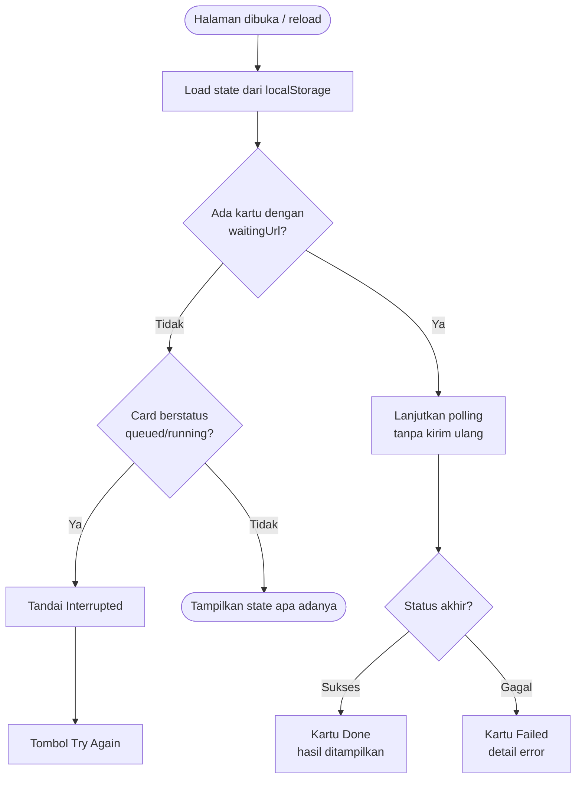

# Dokumentasi Diptera

Dokumentasi ini menjelaskan aplikasi **Diptera** secara menyeluruh: ringkasan, deskripsi,
alur kerja (workflow), aspek keamanan, cara kerja internal, komponen yang digunakan, dan
langkah instalasinya.

---

## 1. Ringkasan

**Diptera** adalah halaman web statis untuk mengirim **banyak form sekaligus** ke workflow
**Charlie Reporter** di **n8n**, memantau setiap eksekusi, lalu menampilkan hasil tiap form
(nama case, severity, dan markdown) langsung pada kartu masing-masing.

Aplikasi ini ditujukan untuk kondisi ketika workflow berjalan lambat (misalnya karena AI lokal):
pengguna dapat mengisi 10 alert terlebih dahulu, menekan **Submit All**, lalu meninggalkan
halaman. Setiap kartu akan memberi tahu sendiri ketika prosesnya selesai.

| Aspek | Keterangan |
| --- | --- |
| Jenis aplikasi | Web statis (HTML + CSS + JavaScript), tanpa framework |
| Backend | Tidak ada backend aplikasi; hanya static file server |
| Integrasi | Langsung ke endpoint **Form** n8n dari browser |
| Penyimpanan | `localStorage` browser (tanpa database) |
| Runtime | Node.js (server statis) atau Docker |
| Dependensi produksi | Tidak ada (hanya modul bawaan Node.js) |

---

## 2. Deskripsi

Diptera memecahkan masalah pengiriman form n8n yang biasanya dilakukan satu per satu.
Alih-alih membuka halaman form n8n berulang kali dan menunggu tiap proses selesai, Diptera
menyediakan banyak kartu form dalam satu halaman:

- Setiap kartu mewakili satu pengiriman form ke workflow n8n.
- Form dapat ditambah, diduplikasi, dihapus, atau dikuncupkan.
- Pengiriman bisa **sequential** (satu per satu, aman untuk AI lokal) atau **parallel**
  (semua sekaligus).
- Setiap kartu memiliki status sendiri: `Waiting`, `Queued`, `Processing`, `Done`, `Failed`.
- Hasil akhir per kartu menampilkan severity, nama case, durasi, ID eksekusi, dan tombol
  **Copy Markdown** / **Copy Case Name**.
- Nomor tiket dan Case ID dapat terisi otomatis (auto-numbering).
- Data dan pengaturan disimpan di browser, sehingga halaman dapat dimuat ulang tanpa
  kehilangan progres.

Aplikasi ini **tidak menggantikan n8n**. Diptera hanya menjadi klien form yang mengirim data
ke form endpoint n8n dan membaca halaman hasil eksekusi.

---

## 3. Workflow

### 3.1 Alur pengguna



### 3.2 Alur protokol ke n8n

Protokol berikut telah diuji terhadap n8n 2.40.7:

```text
POST {base}/form/{path}
     multipart/form-data: field-0 … field-N
  → 200 { "formWaitingUrl": "{base}/form-waiting/<id>?signature=…" }

GET  {formWaitingUrl}/n8n-execution-status
  → running | form-waiting | success | error | crashed | canceled | …

GET  {formWaitingUrl}
  → halaman hasil HTML yang memuat responseHtml workflow

POST {formWaitingUrl}
  → menandai eksekusi selesai di n8n (autoResume, opsional)
```

Catatan penting:

- Workflow n8n harus **aktif/published**; jika tidak, `POST /form/<path>` akan membalas 404.
- Jika workflow tidak memiliki node **Form (Form Ending)**, n8n membalas `{"status":200}`.
  Kartu tetap ditandai **Done** dengan keterangan "no result page".
- Status `running` tidak langsung di-GET untuk halaman hasil karena request dapat menggantung
  di n8n. Diptera menunggu status `form-waiting` atau `success` terlebih dahulu.
- Rute form n8n mengembalikan header CORS yang sesuai, sehingga browser dapat memanggil n8n
  secara langsung tanpa proxy.

### 3.3 Mode pengiriman

| Mode | Perilaku | Cocok untuk |
| --- | --- | --- |
| **Sequential** (default) | Form berikutnya dikirim setelah form sebelumnya selesai | AI lokal / resource terbatas |
| **Parallel** | Semua form dikirim bersamaan | Workflow cepat / server kuat |

### 3.4 Siklus status kartu



Jika halaman ditutup saat pengiriman berlangsung, kartu yang belum terkirim ditandai
**Interrupted** dan dapat dikirim ulang. Kartu yang sudah memiliki `waitingUrl` akan
melanjutkan pemantauan secara otomatis setelah halaman dibuka kembali.

---

## 4. Keamanan

### 4.1 Model keamanan

Diptera adalah aplikasi statis yang berjalan di browser. Tidak ada data form yang dikirim ke
server Diptera; browser berkomunikasi **langsung** dengan n8n. Static server hanya melayani
file aplikasi.

### 4.2 Perlindungan yang sudah diterapkan

| Area | Perlindungan |
| --- | --- |
| **Data sensitif** | Alamat n8n, form path, dan daftar tenant dibaca dari environment (`.env`), tidak ditulis di kode. |
| **Rahasia di repo** | `.env` sudah masuk `.gitignore`, sehingga tidak ikut ter-commit. |
| **Static server** | Hanya file dalam whitelist yang dilayani (`index.html`, CSS, JS, `config.js`). `node_modules` dan `test` tidak terekspos. |
| **Path traversal** | Path diambil dari whitelist, bukan dari URL mentah, sehingga tidak bisa keluar dari folder aplikasi. |
| **Metode HTTP** | Hanya `GET` dan `HEAD`; metode lain dibalas `405 Method Not Allowed`. |
| **Header respons** | `X-Content-Type-Options: nosniff` dan `Cache-Control: no-cache`. |
| **XSS pada UI** | Nilai dinamis di-escape dengan fungsi `esc()` sebelum dimasukkan ke `innerHTML`. |
| **HTML hasil n8n** | Fungsi `sanitizeFragment()` menghapus `<script>`, `<style>`, komentar, `<iframe>/<object>/<embed>/<link>/<meta>/<base>/<form>`, atribut `on*`, dan URL `javascript:`. |
| **Tautan eksternal** | Link ke n8n memakai `target="_blank"` dan `rel="noopener"`. |
| **Container** | Dockerfile menjalankan proses sebagai user non-root (`USER node`). |
| **Batas waktu** | Setiap request memakai timeout dan `AbortController`; pemantauan dibatasi oleh "Result wait limit". |

> **Penting:** sanitasi HTML di `extract.js` berbasis regex dan bersifat perlindungan dasar,
> bukan sanitizer HTML penuh. Karena sumber HTML adalah halaman hasil workflow n8n milik
> organisasi sendiri, risikonya dapat diterima. Jika workflow dapat menghasilkan HTML dari
> input pengguna yang tidak dipercaya, gunakan sanitizer HTML yang teruji di sisi n8n.

### 4.3 Hal yang perlu diperhatikan

- **`localStorage` menyimpan data dalam bentuk plaintext** di perangkat pengguna: isi form,
  hasil, `waitingUrl`, dan referensi nomor. Pada komputer bersama, gunakan **Delete all
  forms** dan jangan biarkan sesi terbuka.
- **Tidak ada autentikasi di Diptera.** Siapa pun yang dapat membuka halaman dan menjangkau
  n8n dapat mengirim form. Jalankan hanya di LAN/VPN tepercaya.
- **URL `form-waiting` mengandung signature.** URL tersebut disimpan di `localStorage` dan
  dapat dipakai untuk membaca/menyelesaikan eksekusi. Perlakukan sebagai rahasia.
- **n8n sebaiknya tidak diekspos ke internet publik.** Karena browser memanggil n8n langsung,
  batasi akses dengan firewall, reverse proxy, HTTPS, dan autentikasi di sisi n8n.
- **Gunakan HTTPS jika melewati jaringan tidak tepercaya.** Diptera sendiri tidak menangani
  kredensial, tetapi data alert dan hasil dapat bersifat sensitif.
- **Firewall:** buka hanya port yang diperlukan (contoh `8787` untuk Diptera dan `5678` untuk
  n8n), dan hanya untuk jaringan yang tepat.

---

## 5. Bagaimana Cara Kerjanya

### 5.1 Inisialisasi

1. `index.html` memuat `config.js`, `numbering.js`, `extract.js`, lalu `app.js`.
2. `server.js` (saat `npm start`) membaca `.env` dengan `process.loadEnvFile()`.
3. Endpoint `/config.js` di-generate dari environment dan mengisi `window.DIPTERA_CONFIG`
   (`baseUrl`, `formPath`, `tenantOptions`, `initialCaseId`, `initialTickets`).
4. `app.js` memuat state dari `localStorage` dengan key **`iris-multi-form.v1`**.
5. Jika state belum ada, aplikasi membuat satu kartu form kosong dan pengaturan default.

### 5.2 Pengiriman form

1. Validasi field wajib (`Case ID` dan `Raw Alert JSON`).
2. Nomor tiket/Case ID yang sedang dipakai disimpan sebagai referensi auto-numbering.
3. `FormData` dibentuk dengan urutan `field-0 … field-N` sesuai definisi field.
4. `POST {base}/form/{path}` dikirim ke n8n.
5. Jika respons berisi `formWaitingUrl`, URL disimpan (dan host-nya dapat ditulis ulang agar
   sesuai Base URL), lalu polling dimulai.
6. Jika respons langsung berupa halaman hasil, hasil langsung diparse dan kartu menjadi Done.

### 5.3 Polling dan pengambilan hasil

- Status dicek ke `{formWaitingUrl}/n8n-execution-status`.
- Interval awal 1 detik, bertambah 20% per iterasi hingga maksimum 5 detik.
- Batas waktu default 30 menit (dapat diubah 1–240 menit).
- Saat status `form-waiting` atau `success`, halaman hasil diambil hingga 4 kali percobaan.
- `extract.js` mencari marker **"Informasi Case IRIS"** / **"Laporan Markdown"**, mengambil
  blok `<pre><code>`, lalu mengekstrak severity, nama case, dan markdown.
- Setelah hasil didapat, Diptera dapat mengirim `POST {formWaitingUrl}` untuk menandai
  eksekusi selesai di n8n (`autoResume`).

### 5.4 Parse hasil (IrisExtract)

`extract.js` mendukung dua format halaman n8n:

1. **Format normal** — `responseHtml` disisipkan sebagai HTML mentah.
2. **Format escaped** — HTML di-escape (`&lt;h2&gt;…`), lalu di-decode sebelum diparse.

Fungsi utamanya:

| Fungsi | Kegunaan |
| --- | --- |
| `parse(html)` | Mengambil `caseName`, `severity`, `markdown`, `fragmentHtml`, `pageText`. |
| `decodeEntities(str)` | Mengubah entitas HTML menjadi karakter asli. |
| `sanitizeFragment(html)` | Membersihkan HTML hasil sebelum ditampilkan. |
| `stripTags(html)` | Mengambil teks polos untuk pesan error. |
| `looksLikeError(text)` | Mendeteksi halaman error n8n. |
| `resolveResultUrl(url, base, rewrite)` | Menyesuaikan host URL hasil dengan Base URL. |
| `execIdFromWaitingUrl(url)` | Mengambil ID eksekusi dari URL `form-waiting`. |

### 5.5 Auto-numbering (IrisNumbering)

Aturan: **angka terakhir** di dalam sebuah nilai dinaikkan satu, sehingga prefix, suffix, dan
zero-padding tetap dipertahankan.

```text
10010            → 10011
#1001            → #1002
ASOC-2026-30073  → ASOC-2026-30074
007              → 008
```

- **Tiket IRIS** memiliki urutan per tenant.
- **Case ID IRIS** memiliki urutan global.
- Nilai yang diketik manual tidak ditimpa dan menjadi referensi nomor berikutnya.
- Referensi disimpan di `localStorage`; tersedia tombol **Forget number reference**.
- Fitur dapat dimatikan melalui **Settings → Auto-fill numbers**.

### 5.6 Penyimpanan dan pemulihan

- Seluruh state disimpan di `localStorage` (`iris-multi-form.v1`).
- Penulisan ditunda saat pengguna mengetik, lalu disimpan setelah blur/jeda dan segera
  di-flush ketika tab disembunyikan/ditutup.
- Saat reload, pemantauan eksekusi yang sedang berjalan dilanjutkan otomatis.
- Jika storage penuh, hasil dibuang lebih dulu dan aplikasi berhenti mencoba berulang kali.

### 5.7 Performa

- Textarea log memakai `wrap="off"` agar browser tidak menghitung ulang layout pada setiap
  ketikan.
- Isi textarea dibuang dari DOM saat kartu dikuncupkan (nilainya tetap aman di state).
- Kartu yang sudah Done hanya menampilkan panel hasil.
- Penambahan/penghapusan kartu tidak membangun ulang seluruh daftar, hanya kartu yang berubah.
- Pemeriksaan JSON saat mengetik di-debounce dan bersifat informatif, bukan syarat submit.

---

## 6. Komponen yang Dipakai

### 6.1 File aplikasi

| File | Fungsi |
| --- | --- |
| `index.html` | Struktur halaman: topbar, panel settings, toolbar, daftar kartu, toast. |
| `styles.css` | Tema gelap, kartu, status chip, panel hasil, toast. |
| `tenants.css` | Gaya tabel Tenant/Number di panel settings. |
| `app.js` | State, penyimpanan, render kartu, submit/poll/resume, toast, settings, auto-numbering. |
| `extract.js` | Parser halaman hasil n8n (`IrisExtract`). |
| `numbering.js` | Helper nomor berikutnya (`IrisNumbering`). |
| `config.js` | Nilai default `window.DIPTERA_CONFIG`. |
| `server.js` | Static server tanpa dependensi: whitelist file, `/healthz`, `/config.js`, cetak alamat LAN. |
| `Dockerfile` | Image Node 22 Alpine, non-root, healthcheck. |
| `docker-compose.yml` | Menjalankan container dengan port dan environment. |
| `.env.example` | Contoh konfigurasi environment. |
| `test/` | Unit test, server test, e2e test, dan fixture halaman hasil n8n asli. |

### 6.2 Teknologi dan API

| Komponen | Peran |
| --- | --- |
| **HTML/CSS/JavaScript vanilla** | Tanpa framework, tanpa proses build. |
| **Node.js `node:http`, `node:fs`, `node:path`, `node:os`** | Static server dan deteksi alamat LAN. |
| **Fetch API** | Komunikasi browser ke n8n. |
| **FormData** | Body `multipart/form-data` berisi `field-0 … field-N`. |
| **AbortController** | Pembatalan request dan timeout. |
| **localStorage** | Persistensi state dan referensi nomor. |
| **Clipboard API** | Tombol Copy Markdown / Copy Case Name. |
| **Notification API** | Notifikasi desktop saat form selesai (opsional). |
| **Docker / Docker Compose** | Paket distribusi tanpa perlu memasang Node.js. |
| **jsdom** | Menjalankan aplikasi nyata di test e2e. |
| **n8n Form Trigger & Form Ending** | Sisi penerima form dan penghasil halaman hasil. |

### 6.3 Pemetaan field n8n

n8n menerima data form dengan key **posisional** sesuai urutan field di node **Form Trigger**:

| Key | Label Diptera | Field workflow |
| --- | --- | --- |
| `field-0` | IRIS Ticket Number (Optional) | `reportNumber` |
| `field-1` | Tenant / Organization (Optional) | `Tenant` |
| `field-2` | IRIS Case ID (wajib) | `irisId` |
| `field-3` | Raw Alert JSON (wajib) | `Raw Alert JSON` |

Jika field di form n8n ditambah atau diurutkan ulang, ubah **Form field definitions (JSON)**
di panel Settings agar urutannya tetap sesuai.

---

## 7. Cara Instalasi

### 7.1 Prasyarat

- **Node.js 20.12+** (disarankan Node 22) dan npm — untuk menjalankan tanpa Docker.
  `server.js` memakai `process.loadEnvFile()` yang tersedia sejak Node 20.12.
- **Docker + Docker Compose** — opsional, untuk distribusi container.
- **n8n** yang dapat diakses dari browser, dengan workflow Charlie Reporter berstatus aktif.
- Browser modern (Chrome/Edge/Firefox/Safari terbaru).

### 7.2 Instalasi lokal (Node.js)

```bash
# 1. Masuk ke folder proyek
cd diptera

# 2. Buat file environment
cp .env.example .env

# 3. Edit .env sesuai lingkungan
#    N8N_BASE_URL, DIPTERA_FORM_PATH, TENANT_OPTIONS, ...
nano .env

# 4. Pasang dependensi (jsdom untuk test)
npm install

# 5. Jalankan server
npm start
```

Buka <http://localhost:8787>. Saat start, server mencetak alamat **Local** dan **Network**:

```text
  Diptera
  -------------------------------------------------
  Local      : http://localhost:8787
  Network    : http://192.168.1.10:8787
  -------------------------------------------------
```

Gunakan alamat **Network** dari PC/ponsel lain di Wi-Fi/LAN yang sama. Jangan membuka
`index.html` lewat `file://`, karena clipboard, notifikasi desktop, dan storage lebih andal
ketika halaman disajikan melalui HTTP.

#### Konfigurasi `.env`

```dotenv
# Alamat n8n (harus dapat dijangkau langsung oleh browser)
N8N_BASE_URL=http://localhost:5678

# Path node "Alert Intake Form" pada workflow n8n
DIPTERA_FORM_PATH=nama-form-workflow

# Daftar tenant untuk dropdown (JSON array) — wajib agar dropdown terisi
TENANT_OPTIONS=["tenant-a","tenant-b"]

# Opsional: nomor awal per tenant (JSON object)
# INITIAL_TICKETS={"tenant-a":"10000","tenant-b":"20000"}

# Opsional: Case ID global awal
# INITIAL_CASE_ID=#1001

# Opsional: alternatif INITIAL_TICKETS (tenant + nomor awal dalam satu map)
# INITIAL_TENANTS={"tenant-a":"10000","tenant-b":"20000"}
```

Jika `N8N_BASE_URL` kosong, aplikasi menebak dari alamat halaman:
`http://localhost:5678` untuk localhost, atau `http://<IP-halaman>:5678` untuk akses via IP.

### 7.3 Instalasi dengan Docker

```bash
# Build dan jalankan
docker compose up -d --build

# Buka http://localhost:8787 atau http://<IP-PC>:8787
```

Ganti port host jika `8787` sudah dipakai:

```bash
APP_PORT=9080 docker compose up -d --build
```

Isi Base URL default untuk browser yang belum punya pengaturan tersimpan:

```bash
N8N_BASE_URL=http://192.168.1.10:5678 docker compose up -d --build
```

Perintah Docker alternatif:

```bash
docker build -t diptera:latest .
docker run -d --name diptera --restart unless-stopped -p 8787:8787 \
  -e N8N_BASE_URL=http://192.168.1.10:5678 \
  -e DIPTERA_FORM_PATH=nama-form-workflow \
  diptera:latest
```

#### Memindahkan image ke PC lain tanpa internet

```bash
# Di PC sumber
docker save diptera:latest -o diptera.tar

# Salin diptera.tar ke PC tujuan, lalu:
docker load -i diptera.tar
docker run -d --name diptera --restart unless-stopped -p 8787:8787 diptera:latest
```

Atau salin seluruh folder proyek (tanpa `node_modules`) ke PC tujuan yang memiliki Docker,
lalu jalankan `docker compose up -d --build`.

### 7.4 Firewall dan akses LAN

Jika halaman tidak dapat dibuka dari perangkat lain:

1. Pastikan server hidup dari PC lain: `http://<IP-PC>:8787/healthz` harus menampilkan `ok`.
2. Jangan memakai `localhost` dari perangkat lain — gunakan IP PC server.
3. Izinkan port di firewall:
   - **Linux (ufw):**
     ```bash
     sudo ufw allow 8787/tcp   # Diptera
     sudo ufw allow 5678/tcp   # n8n (sesuaikan port)
     ```
   - **Windows:** Windows Defender Firewall → Advanced settings → Inbound Rules → New Rule
     → Port → TCP `8787` → Allow.
4. Pastikan perangkat berada di jaringan yang sama dan tidak terblokir VPN/guest network.
5. Jangan bind server ke `127.0.0.1`; default `HOST=0.0.0.0` sudah benar.
6. Jika n8n berjalan di PC yang sama, port n8n juga harus diizinkan.

Jika halaman terbuka tetapi submit gagal saat diakses via IP, Base URL n8n juga tidak boleh
`localhost`. Gunakan **Settings → Use this page's IP**, lalu **Save settings**.

### 7.5 Konfigurasi di panel Settings

Setelah aplikasi terbuka, klik ikon gear dan sesuaikan:

| Pengaturan | Default | Keterangan |
| --- | --- | --- |
| n8n Base URL | otomatis | `http://localhost:5678` atau `http://<IP-halaman>:5678`. |
| Form path | dari `.env` | Path node Alert Intake Form. |
| Submission mode | Sequential | Sequential atau Parallel. |
| Result wait limit | 30 menit | Batas tunggu sebelum kartu ditandai gagal. |
| Auto-fill numbers | aktif | Tiket per tenant + Case ID berurutan. |
| Auto-collapse card | aktif | Kartu dikuncupkan saat dikirim. |
| Mark done in n8n | aktif | Kirim POST ke `form-waiting` setelah hasil didapat. |
| Rewrite result URL host | aktif | Menyesuaikan host URL hasil dengan Base URL. |
| Desktop notification | nonaktif | Notifikasi saat tab tidak aktif. |
| Tenant list & numbering | dari `.env` | Kelola tenant, nomor awal, dan Case ID berikutnya. |
| Form field definitions | 4 field default | Urutan field harus sama dengan Form Trigger n8n. |

### 7.6 Menjalankan test

```bash
npm test            # unit + server + e2e
npm run test:unit   # numbering + extract + server (tanpa jsdom)
npm run test:e2e    # aplikasi nyata di jsdom + mock n8n
```

Cakupan test:

- `test/numbering.test.js` — 7 test auto-numbering.
- `test/extract.test.js` — 12 test parser memakai halaman hasil n8n 2.40.7 asli.
- `test/server.test.js` — 7 test server: aset, `/healthz`, `config.js`, whitelist, path
  traversal, metode HTTP, dan filter interface virtual.
- `test/e2e.test.js` — alur lengkap dengan mock n8n: tambah/hapus form, submit sequential/
  parallel, hasil per kartu, rewrite URL, autoResume, error + retry, auto-numbering, dan
  resume setelah reload.

Jika container n8n test tersedia di `127.0.0.1:5679`, satu skenario tambahan dijalankan
terhadap n8n nyata. Nonaktifkan dengan `IRIS_E2E_SKIP_REAL=1`.

### 7.7 Troubleshooting singkat

| Gejala | Penyebab umum | Solusi |
| --- | --- | --- |
| Halaman tidak terbuka dari perangkat lain | Firewall / beda jaringan / `localhost` | Buka `http://<IP-PC>:8787/healthz`, izinkan port, gunakan IP PC. |
| Submit gagal / CORS | Base URL salah atau n8n tidak terjangkau | Perbaiki Base URL, pastikan n8n berjalan dan port terbuka. |
| n8n membalas 404 | Workflow belum aktif atau Form path salah | Aktifkan/publish workflow dan periksa `DIPTERA_FORM_PATH`. |
| Kartu Done tanpa hasil | Workflow tidak punya node Form Ending | Tambahkan node Form di akhir workflow. |
| Hasil tidak muncul / timeout | Workflow masih berjalan atau AI lambat | Naikkan wait limit, cek eksekusi di n8n, klik **Check Result Again**. |
| Port 8787 dipakai | Proses lain memakai port | `PORT=8788 npm start` atau `APP_PORT=9080 docker compose up`. |
| Dropdown tenant kosong | `TENANT_OPTIONS` tidak diisi | Isi `TENANT_OPTIONS` di `.env` lalu restart. |
| Pengaturan tidak pindah antar alamat | `localStorage` terpisah per origin | Atur ulang di alamat baru atau gunakan **Use this page's IP**. |

---

## 8. Flowchart

Diagram di bawah menggunakan **Mermaid** dan akan tampil otomatis di GitHub, GitLab, VS Code
(extension Markdown Preview Mermaid), serta banyak editor Markdown lainnya.

### 8.1 Flowchart pengiriman dan polling



### 8.2 Flowchart keputusan status hasil



### 8.3 Flowchart instalasi



### 8.4 Flowchart pemulihan setelah reload



---

## 9. Ringkasan Alur Data

```text
┌──────────────────────────── Browser ────────────────────────────┐
│  index.html + app.js                                            │
│    │                                                            │
│    ├── localStorage  ← state, hasil, auto-number reference      │
│    │                                                            │
│    ├── POST /form/{path} ──────────────┐                        │
│    ├── GET  /n8n-execution-status ─────┤                        │
│    ├── GET  {formWaitingUrl} ──────────┼──► n8n (Charlie        │
│    └── POST {formWaitingUrl} ──────────┘     Reporter workflow) │
└─────────────────────────────────────────────────────────────────┘

server.js (opsional)
  └── menyajikan file statis + /config.js dari environment + /healthz
```

Dengan rancangan ini, Diptera tetap ringan, tidak menyimpan data di server, dan dapat
dipindahkan antar PC hanya dengan Node.js atau satu image Docker.
